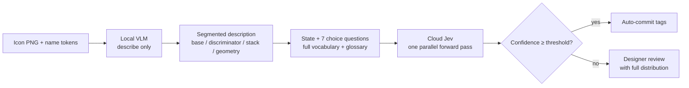

import BlogHeader from '../BlogTitle';
import FeedbackFooter from '../FeedbackFooter';
import Image from 'next/image';
import heroimage from './hero-image.png';
import agreementimage from './agreement-vs-accuracy.png';

export const metadata = {
  title: "Icon ➜ Tags: Splitting Perception from Decision (Part 2)",
  description:
    "Part 2 delivers the promised zero-shot VLM tagging run — and shows why its n-sample agreement cannot serve as a confidence signal. The fix is not a better prompt: the pipeline now splits perception (a local VLM describing icons) from decision (a calibrated System One model choosing tags).",
  openGraph: {
    title: "Icon ➜ Tags: Splitting Perception from Decision (Part 2)",
    description:
      "The zero-shot VLM tags icons in production, but near-identical agreement pairs with 92.5% accuracy on one facet and 27.6% on another. Time to stop asking a generator to make decisions.",
    url: "/blog/icon-auto-tagging-p2",
    images: [
      {
        url: "/images/icon-auto-tagging/social-thumbnail-p2.jpg",
        alt: "Icon ➜ Tags — Part 2",
      },
    ],
  },
  twitter: {
    title: "Icon ➜ Tags: Splitting Perception from Decision (Part 2)",
    images: ["/images/icon-auto-tagging/social-thumbnail-p2.jpg"],
  },
};

<BlogHeader title="Icon ➜ Auto-Generated Tags" subtitle="Splitting Perception from Decision (Part 2)" postDate="2026-09-19" />

<Image src={heroimage} priority alt="Icon ➜ Tags Part 2: a VLM describes the icon, a System One model makes the tag decisions." />

## Introduction

In [Part 1](/blog/icon-auto-tagging-p1), two Adobe icon designers built a six-facet controlled vocabulary for a library of 30,000+ icons, and I promised a zero-shot vision-language model would start filling it in. This post keeps that promise — then breaks the system it describes. The VLM ran in production, and it works. What it cannot do is say when it doesn't know: a generative model has no honest confidence signal, and no prompt can add one. Without it, the pipeline has no principled way to decide which tags to trust and which to route to a human.

The fix was a re-architecture, not a better prompt. The job is now split — a local VLM *perceives* (describes the icon in prose), and a new kind of model, a System One decision engine, *decides* (assigns tags with calibrated probabilities).

## TL;DR

- The zero-shot pipeline (a 27B VLM generating all facets in one pass) works, and after RLHF its token logprobs are too overconfident to use as confidence — so we sampled each icon 5 times and voted.
- Voting agreement has only 5 possible values, 3 usable thresholds — and at near-identical agreement, correctness runs 92.5% on `discriminator` and 27.6% on `action`. It is a broken confidence signal, structurally — not a tuning problem.
- Three more structural faults: cross-facet interference in autoregressive output, a fixed thinking budget diluted across 7 facets, and a 7×5=35-pass cost explosion if you try to fix interference by splitting.
- The new architecture: **perception and decision are now different models.** A local VLM writes a segmented natural-language description; [Jev](https://docs.typesafe.ai/), the first "System One" model, scores all 7 facets against the full vocabulary in one parallel forward pass, each facet isolated, with calibrated confidence.
- Deterministic routing closes the loop: high-confidence facets auto-commit, low-confidence ones go to a designer — with the full probability distribution, not a single guess, to review.

## 1. The zero-shot VLM, as promised

Here is the system Part 1 promised, exactly as it ran in production.

The model is **Qwen3.8-27B** — specifically [lued/Qwen3.8-27B-INT8-W8A16-MTP](https://huggingface.co/lued/Qwen3.8-27B-INT8-W8A16-MTP), a weight-only INT8 build (8-bit weights, 16-bit activations) with multi-token prediction for faster decoding. The quantization is a hardware decision, not a cost corner: the production cluster is Ampere-generation GPUs, which have no FP8 tensor cores, so the FP8 and NVFP4 variants of the same model were non-starters there. INT8 weights plus an FP8 KV cache is as far as that silicon can be pushed.

vLLM serves it: every icon enters one continuously-batched job, tensor-parallel across 8 GPUs in production (2 on the dev box). Prefix caching earns its keep here — the system prompt, carrying the tagging rules and the full seven-facet glossary, measures about 5,000 tokens at the long end (100 of them image tokens), and the 9,216-token context was deliberately sized as longest prompt plus 4,096 output plus a sliver of headroom. The prompt is identical for every icon, so it is prefilled once and reused 3,137 times.

Each icon gets one generation: look, think (Qwen3-style reasoning, stripped before parsing), then emit a single JSON object carrying all seven facets — plus, incidentally, a plain-text `description` of what the model saw. Remember that field; it earns a starring role in section 6. The vocabulary itself grew after Part 1: `color_mode` joined the original six facets.

And because a single generation at temperature 1.0 is a roll of the dice, we rolled five: `n=5`, `top_p=0.95`, majority vote per facet, and an `agreement` score — votes over five.

The first production run's ledger: **3,137 icons**, five generations apiece, in about three and a half hours of active inference — roughly four seconds per icon. Of the 15,685 samples, exactly three came back unparseable — the model thought past `max_tokens` and the JSON never closed — on three icons: `LockPartial`, `PhoneCallSecurity`, and `SandboxSettings`. Each still had four valid votes, so majority voting papered over the hole, silently. Truncation returns in section 4; the silence is part of the story.

## 2. Voting was a workaround, not a feature

Section 1 presented `n=5` and voting as if they were design choices. They were not; they are a detour, and the closed road that forced it is worth understanding, because it sets up everything that follows.

An autoregressive model ships with an obvious confidence signal: the logprobs of the tokens it emits. In principle a token drawn at 0.99 deserves more trust than one drawn at 0.55, and a routing threshold — auto-commit above, human review below — is just a line drawn between them. In practice, alignment training ruins this. RLHF-style reward models favor answers that sound sure, so the model learns to sound sure; the emitted probabilities stop tracking truth and collapse toward 1.0. The overconfidence is severe enough that a wrong answer's logprobs are routinely indistinguishable from a right one's. What a routing system needs is a model that says "I don't know"; what an aligned generator is trained never to say is "I don't know."

With logprobs off the table, we reached for the statistician's fallback: if you cannot trust one draw, sample the distribution. Five generations per icon at temperature 1.0, a majority vote per facet, and agreement — votes over five — standing in for confidence. Frequency replaces probability.

The price is structural. Five generations where one should do — five times the decode work, five times the KV-cache churn — to purchase a single number. Continuous batching is what makes the tax survivable, and also what hides it: roughly four seconds per icon feels tolerable until you remember that four of every five generations are spent manufacturing that number. The next section is where I have to confess what the number turned out to be worth.

## 3. Agreement is a broken confidence signal

This is the heart of the post, so let me start with the number that ended the argument. The latest benchmark run — 134 labeled icons, 670 of 670 samples valid — reports, for every facet, how often the five samples agree with each other, and how often the majority vote actually matches the designer's label:

| Facet | Avg. agreement | Accuracy |
| ----- | ----- | ----- |
| color_mode | 97.2% | 88.1% |
| action | 94.3% | 27.6% |
| discriminator | 93.6% | 92.5% |
| object | 90.4% | 64.9% |
| interaction_mode | 90.1% | 73.9% |
| category | 89.6% | 56.7% |
| visual_trait | 81.8% | 33.6% |

Read rows two and three together. `action` agrees with itself *more* often than `discriminator` does — 94.3% versus 93.6% — and is right less than a third as often. Agreement is doing exactly what it measures and nothing else: it reports self-consistency. From the inside, a model that is reliably wrong looks identical to a model that is reliably right. Voting cannot tell those two machines apart, because the vote is cast by the same machine that made the guess.

  <Image src={agreementimage} alt="Paired horizontal bars per facet, sorted by agreement: agreement in cyan, accuracy in amber. action shows the steepest gap — 94.3% agreement against 27.6% accuracy." />

So agreement is not correctness. The three structural failures below are why it cannot even be *used* as if it were:

**Five values, three usable thresholds.** $agreement = votes/5$ can only be $\{0.2, 0.4, 0.6, 0.8, 1.0\}$, and most icons pile up at the top, so the thresholds that actually separate anything are only $\ge 0.6$, $\ge 0.8$, $= 1.0$. There is no knob between them: a business goal like "88% automation at 95% precision" is mathematically inexpressible. The dial has three settings, and the middle one does not exist.

**The same threshold means different things on different facets.** A routing threshold is one number pointed at seven different dials. As the table above shows, facets running at near-identical agreement carry wildly different reliability — so any single setting either lets `action`'s wrong tags straight into the library, or sits so high that half the icon set lands in human review. A unified routing criterion has to mean the same thing everywhere it is applied. Agreement cannot.

**Too coarse to rank, or to offer a shortlist.** To be fair, the runner-up votes are not lost — `evaluation.py` persists full `counts` and `unique_values`, so margins are computable. The problem is resolution: with n=5, margin can only take six values. Five samples voting `[tools, tools, tools, 3d, 3d]` give margin 0.2 whether the true distribution is a coin flip (must go to review) or a robust 0.58-vs-0.12 lead (safe to auto-accept). Entropy is worse: estimating entropy over 29 (`category`) to 95 (`object`) classes from 5 samples yields bias larger than the signal. So the system cannot even hand designers a reliable "pick one of these two" shortlist.

## 4. Three more faults that prompting cannot fix

**Cross-facet interference.** One generation produces all 7 facets sequentially; the causal attention mask means every earlier facet becomes context for the later ones. Hesitation or hallucination on facet 1 cascades. The facets were designed to be independent — the generation is not.

**A diluted, unobservable thinking budget.** `reasoning_effort="medium"` and `max_tokens=4096` cover *both* "understand the drawing" *and* "decide 7 facets". Facets late in the sequence get whatever budget is left. The 3 nulls in the first 3,137-icon run are direct evidence of truncation on hard icons. And note what agreement cannot see here: all 5 samples of a hard icon face the *same* budget, so they can converge — "consistently under-thought, consistently wrong". Sampling consistency and thinking sufficiency are orthogonal. Worse, reasoning-token length was never recorded, so the truncation rate is currently unmeasurable — and you cannot tune what you cannot see.

**The 35-pass explosion.** The obvious fix for interference — score each facet in its own generation — multiplies cost: 7 facets × 5 samples = 35 generative passes per icon. Unacceptable in a production pipeline, however good the batching.

## 5. A different kind of model: System One

In September 2026, TypeSafe AI released [Jev](https://docs.typesafe.ai/), which they call the first "System One" model. The name is a nod to Kahneman. Software is full of judgments that are, in his terms, System 1 — fast, intuitive calls like *which team gets this ticket*, *is this refund justified*, *which tag fits this icon*. We have been running all of them on System 2 machinery: generative models built to deliberate in prose. Jev is built for the fast calls instead.

Mechanically it is less like a chatbot and more like a typed function. You send a **state** — any text carrying the context — and typed **questions**: `choice` (pick one option from a described list), `noul` (a yes/no probability), `score` (a value against a rubric). A single forward pass scores every question in parallel. Nothing is generated, so there are no output tokens — which is why pricing reads like a database's, not a model's: $0.042 per million input tokens, output free.

The property that ended our search: the answers come back **calibrated**. Each `choice` returns the full probability distribution across every option, plus a confidence derived from that distribution, and the model is trained so those probabilities align with outcomes — it knows when it doesn't know. That is precisely the property alignment training destroys in a generator's logprobs, and here it comes without sampling tricks: no n=5, no voting. The distribution *is* the answer, and margins, entropy, and top-k fall out of it as real numbers instead of five-vote shadows.

The constraints, verified against the docs: up to **255 options per choice question**; 64k tokens per request, with a 32k cap across the state and the longest single question; and **text-only input** — no images, no audio.

That last limit sounds like a disqualifier for a vision task. It turned out to be the forcing function for the whole redesign.

## 6. The new pipeline: the VLM perceives, Jev decides

Four steps, one division of labor: **the VLM never picks a tag, and Jev never sees a pixel.** Each model does only the half of the job it is structurally good at, and every task the old design asked one model to do badly has been moved across the boundary.

**Step 1 — perception only (local VLM).** Qwen still sees the image and the name tokens, but its whole thinking budget now serves one job: *describe what this drawing is*, in natural language, no tag vocabulary in the prompt, no choices to make. The description is written in mandatory segments: a **base** paragraph (the core entity and its strokes), a **discriminator** paragraph (any small overlaid marker with knockout gaps — or an explicit "none"), a **stack** paragraph (same-shape offset overlap, if present), and a **fallback geometry** paragraph for parts whose meaning resists identification (describe the lines, closed or open, symmetry — don't guess a concept).

Two design arguments to carry into the post:

- *Why segmentation must happen here:* rules like "remove the small mark — does the core meaning survive?" (the `object` vs `discriminator` arbitration) or "same-shape offset overlap is `visual_trait: stacked`, not a discriminator" are **cross-facet judgments that need the pixels in hand**. Jev scores facets in absolute isolation by construction — it must never be asked to arbitrate between them. Once the description flattens the layers, `object` and `discriminator` end up fighting over the same text.
- *Why natural language, not `base=`/`discriminator=` keys:* key names tempt the VLM to emit vocabulary-style short words (`plus`), which collapses the description back into implicit tagging — the exact old failure — and throws away the detail Jev needs. Constrain the *structure*, keep the *prose*.

**Step 2 — assemble the payload.** The description becomes the `state`. Each facet becomes one `choice` question whose options are the **full vocabulary with glossary explanations** — the docs explicitly recommend complete lists over shortlists, plus an `other` / none-of-the-above catch-all, which is exactly our `other` and empty-string conventions from Part 1. Capacity check against the 255-option and token limits:

| Facet | Candidates (incl. `other` + empty) | Headroom to 255 |
| ----- | ----- | ----- |
| object | 97 | 158 |
| action | 62 | 193 |
| discriminator | 35 | 220 |
| category | 31 | 224 |
| interaction_mode | 20 | 235 |
| visual_trait | 19 | 236 |
| color_mode | 6 | 249 |

(All seven facets ship in a single request; the largest facet uses 38% of its per-question limit. One amusing coincidence: the seven candidate lists happen to sum to exactly 256, which is easy to mistake for a tight fit against the 255 cap — but the cap is per *question*, not per request.)

**Step 3 — one parallel pass (cloud Jev).** All 7 facets scored in one forward pass, mathematically isolated from each other — no causal mask, no cascade, no shared thinking budget. Each answer arrives as a probability distribution with calibrated confidence. And because Jev is text-only, **no image asset ever leaves the building** — only a description does.

**Step 4 — deterministic routing.** Plain code, per facet: confidence above the bar (say 95%) auto-commits; below it, the icon goes to a designer — who now reviews a *full distribution* (margin, entropy, top-k candidates) instead of a single unexplained guess. The continuous confidence scale makes the threshold an actual dial again, tunable per facet.

## 7. Old vs new

Where the two designs stand, side by side:

| Dimension | Pure VLM (n=5 voting) | VLM describe + Jev decide |
| ----- | ----- | ----- |
| Compute per icon | 5 autoregressive generations (slow even batched) | 1 generation + 1 non-generative scoring pass |
| Cross-facet interference | Severe (shared causal context) | None (facets scored in isolation) |
| Confidence | RLHF-polluted logprobs → 5-level agreement → 3 usable thresholds, accuracy drifting 92.5%→27.6% across facets | Calibrated probabilities; continuous per-facet thresholds |
| Review handoff | A single majority guess | Full distribution: margin, entropy, top-k shortlist |
| Data boundary | Everything stays local | Images stay local; text descriptions go to cloud |

## 8. Honest limitations

- **The compliance trade is real.** Descriptions of unreleased icons now leave our perimeter. No image assets, no filenames of consequence — but it is a genuine compromise, decided deliberately, not hand-waved.
- **Jev is young.** Version 1.13, released September 2026; English best-supported. TypeSafe itself publishes a [jaggedness page](https://docs.typesafe.ai/model-jaggedness/jev-1.13) of known failure modes — literal reading, context rot from bloated state, arithmetic — which is exactly the kind of honesty we want in a vendor, and a checklist our payload already respects: compact state, no math, no generation asked. Still, a calibrated confidence claim is only as good as the model behind it — Part 3 must validate calibration on *our* facets before any threshold goes live.
- **Ceilings exist.** 255 options per question and 64k tokens per request are far away today; if a facet outgrows them, the documented path is hierarchical choices with beam search — more moving parts.
- **The perception ceiling moved, not vanished.** If the VLM's description omits or blurs a layer, Jev's calibration will *honestly report* low confidence — which is exactly the behavior we want, but it means the description prompt is now the quality ceiling of the system.

## What's next

Part 3 will run the new pipeline across the library and answer the only question that matters: does Jev's confidence actually hold calibrated precision on our facets, per facet, at the thresholds the business wants? The benchmark set of hand-labeled icons is waiting.

To be continued...

<FeedbackFooter />
