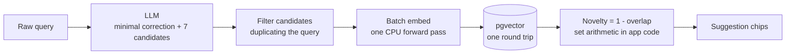

import BlogHeader from '../BlogTitle';
import FeedbackFooter from '../FeedbackFooter';
import Image from 'next/image';
import heroimage from './hero-image.png';
import vennimage from './novelty-venn.jpeg';

export const metadata = {
  title: "Novelty over Relevance: Rethinking Search Suggestions",
  description:
    "The user who needs a search suggestion has already rejected their results — so ranking suggestions by relevance just re-serves what they passed on. Ranking by novelty does the opposite.",
  openGraph: {
    title: "Novelty over Relevance: Rethinking Search Suggestions",
    description:
      "Why the best search suggestion is the one that takes you somewhere you haven't been — and how result-set overlap against a grounded baseline makes it measurable.",
    url: "/blog/novelty-over-relevance",
    images: [
      {
        url: "/images/novelty-over-relevance/hero.png",
        alt: "Novelty over Relevance — suggestion chips under a search box",
      },
    ],
  },
  twitter: {
    title: "Novelty over Relevance: Rethinking Search Suggestions",
    images: ["/images/novelty-over-relevance/hero.png"],
  },
};

<BlogHeader title="Novelty over Relevance: Rethinking Search Suggestions" subtitle="The best suggestion takes you somewhere you haven't been" postDate="2026-08-30" />

<Image src={heroimage} alt="A search box reading calendar, with a row of suggestion chips offering different directions: schedule, planner, date picker, agenda." />

## Introduction

You buy a pair of running shoes, and for the next two weeks half the internet tries to sell you running shoes. Not other shoes you might like — the same ones, from the same store, sometimes in the same size. Ads that recommend products you have already seen and passed on, or have literally just bought, are the most familiar spam on the web.

Search suggestions quietly suffer from the same disease. In [Icon Search](/blog/icon-in-action) — the multimodal search system over Adobe's icon library of roughly 32,000 icons — a disappointing query deserves better than a shrug. So when the results underwhelm, we now show a row of suggestion chips: alternative search terms, one tap away.

The standard playbook ranks those suggestions by *relevance* — how close each candidate is to what the user typed. This post is about why that is exactly backwards.

The person who needs a suggestion is not someone who has yet to search. It is someone who has already seen the results for their query — and rejected them. For that person, a "more relevant" suggestion is a retargeting ad: the same icons, served under a different word. What they need is a term that takes them somewhere they haven't been.

## 1. A more relevant suggestion is a wasted vote

Suppose a designer searches for `calendar` and is unimpressed by what comes back. The reflexive suggestions — the ones most similar to the original query — look helpful: `calendar icon`, `calendars`, `calendar outline`. But every one of those terms retrieves essentially the same icons the designer just scrolled through and dismissed. The suggestions are relevant. They are also worthless.

The failure mode is structural, not incidental: the more similar a suggestion is to the original query, the more its results converge on the result set the user already rejected. Synonyms, plural variants, cosmetic rewordings — they don't change where the search lands, they just re-serve it. Ranking suggestions by similarity to the query optimizes for the opposite of what an unhappy user needs. It is the retargeting ad, reborn inside your own search box.

What actually helps is the other kind of suggestion: `schedule`, `planner`, `date picker`, `agenda`. Terms that are admittedly *less* like the query — but land on icons the user hasn't seen yet. Which raises the real question: how do you measure "somewhere they haven't been", mechanically?

## 2. Novelty: rank by where a suggestion takes you

Here is the entire mechanism. Every suggestion is treated as a real query: run it against the icon library, keep the top 20 icons it retrieves, and call that its **result set**. Do the same for a **trusted baseline** — the term representing what the user actually wanted. Then:

$$
\text{Overlap} = \frac{|\text{Baseline} \cap \text{Suggestion}|}{|\text{Suggestion}|}
$$

$$
\text{Novelty} = 1 - \text{Overlap}
$$

A suggestion that retrieves mostly icons the user has already seen scores near zero — a wasted vote. A suggestion that opens genuinely new ground scores near one. Sort descending, and the chips are ordered by where they can take the user, not by how well they echo what was typed.

  <Image src={vennimage} alt="Two Venn diagrams: a suggestion whose result set heavily overlaps the baseline scores novelty near zero; a suggestion with almost no overlap scores novelty near one." />

**Compare results, not scores.** The cheaper alternative — rank suggestions by embedding similarity, or by vector distance to the query — is the one we deliberately rejected. This project has never trusted absolute similarity scores: they drift with the model, they resist calibration, and a distance tells you two *words* are related without telling you whether they retrieve different *icons*. `calendar` and `schedule` are close as words; comparing words is precisely the retargeting trap. The result set, by contrast, is the user experience itself — measuring it directly means measuring the thing that matters. And set arithmetic has no calibration problem: there is no threshold to tune and no score scale to internalize. Two result sets overlap, or they don't.

**The engineering fits in one paragraph.** The baseline and all candidate terms go through the embedding model in a single CPU forward pass, then a single PostgreSQL round trip — pgvector, with `unnest ... WITH ORDINALITY` fanning the batch out through `LATERAL` index scans — brings back every result set at once. The set arithmetic runs in application code, where it is boring, deterministic, and unit-testable. All of this sits on the same fine-tuned SigLIP2 retrieval that powers [Describe search](/blog/from-figma-to-siglip2-icon-encoder-p1).

**Novelty is not the enemy of relevance — it is built on it.** Candidates are not random words. They come from an LLM asked for *improvements* of the original query in five directions: fix a typo, adjust the plural, swap in a synonym, broaden the scope, narrow it. Every candidate is relevant to the query by construction. Relevance is the admission criterion; novelty is the ranking. Relevance decides who gets on the ballot, novelty counts the votes.

## 3. The trusted baseline, and what grounding buys

Novelty is measured *against* something: the result set of the term representing what the user actually wanted to search for. Getting that baseline right is where the remaining design lives.

**Clean input: the query is its own baseline.** If the user typed `calendar` and `calendar` is a word, the baseline is `calendar`.

**Misspelled input: swap the baseline, don't abandon it.** A user who types `calender` — or `pattern`, meaning `patten` — has not lost their baseline. It is polluted, not absent, and LLM knows what they meant. Alongside the candidates, the model returns a misspelling flag and a *minimal correction*: fix the spelling, change nothing else — no synonyms, no rewording, no touched plurals. When the flag is set, the corrected term becomes the baseline (and the first chip, pinned to the top: *Did you mean "calendar"?*). One rule now covers both cases — novelty against a trusted baseline — and a degenerate branch dies with it: nothing in this design ever sorts by vector distance, not even as a fallback. That door stays closed.

The deeper idea underneath both cases is **grounding**: every suggestion — and the baseline — is actually queried against the real database before the user ever sees it. Grounding buys two things, and they are worth keeping separate.

1. **It turns guesses into facts.** Every suggestion starts life as a guess: the LLM invents plausible terms, and lookups in our controlled vocabulary contribute others. Whether `planner` retrieves three thousand icons or three is unknowable until something hits the database. Grounding runs that query, and any suggestion that comes back empty — or below a floor — is filtered before rendering. The saddest possible outcome for a suggestion feature is a user who trusts your chip, taps it, and lands on a dead end. Grounding is how we keep that from happening.

2. **It gives the novelty arithmetic precise inputs.** `novelty = 1 − overlap` is set arithmetic over retrieval results. It deserves real result sets, not model-claimed relevance and not estimated similarity. Measured sets, or nothing.

There is one edge case. If the baseline query itself retrieves almost zero results, we cannot calculate meaningful novelty. In this situation, we return the candidate suggestions in the order generated by the LLM. We intentionally do not use vector distance ranking even in this specific case.

## 4. The background, compressed

The search suggestion endpoint operates as a stateless pure function. It takes a raw query as input and returns three to five ranked terms. We use Azure OpenAI's `gpt-5.4-nano` model, which is optimized for low-latency extraction and ranking tasks. We pin the model to a specific version date to prevent unexpected behavior changes from automatic model updates. The temperature is set to zero to ensure consistent outputs. The model output must follow a strict JSON schema containing the corrected query, a misspelling flag, and exactly seven candidates. Generating seven candidates ensures we have three to five left after the grounding filters are applied.

## 5. Honest limitations

**Valid word typos beat us.** Type `form` while meaning `from` and both are valid dictionary words. The model might confidently misinterpret the user's intent. Fixing this requires complex natural language understanding, which is out of scope for this feature. We accept this limitation.

**System latency is real.** The process is serial: LLM generation, embedding, and database retrieval. This is slower than the main search API. To resolve this, the frontend request is asynchronous and non-blocking. The primary search results render immediately and do not wait for the suggestions. The suggestion chips fade in later. If the suggestions load too slowly for a specific user session, the analytics will reflect it, but it does not block the core search experience.

A suggestion's purpose is not to repeat what the user typed. Its purpose is to provide users with new, relevant paths to explore.

<FeedbackFooter />
